  

 

  

  

  

  

 

<a href="#!">
  <picture>
    <source media="(prefers-color-scheme: dark)" srcset="https://raw.githubusercontent.com/Baldyl66/Baldyl66/output/pacman-contribution-graph-dark.svg" />
    <source media="(prefers-color-scheme: light)" srcset="https://raw.githubusercontent.com/Baldyl66/Baldyl66/output/pacman-contribution-graph.svg" />
    
  </picture>
</a>

<!-- SPOTIFY : remplace TON-APP par ton domaine Railway puis enleve les balises de commentaire
 

-->

